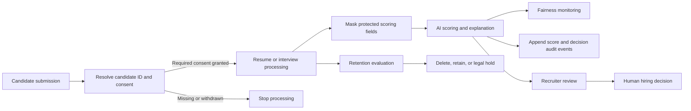

# ZECPATH AI: Day 55 Compliance and Security Deliverable

**Deliverables:** AI compliance design, security framework, governance documentation  
**Document version:** 1.0  
**Prepared:** 2026-10-19  
**Status:** Internal design and implementation summary; not a legal certification or production security attestation.

## Executive summary

ZECPATH AI processes resumes, screening answers, interview information, scores,
and recommendations. These records may contain sensitive personal information
and can affect employment opportunities. The system therefore needs purpose
limits, explicit consent, fair and explainable assessment, human oversight,
controlled access, auditable actions, secure storage, and enforceable retention.

The repository contains several useful controls: fairness masking and analysis,
score and decision audit logging, consent and retention managers, and a
default-deny role policy. The Day 55 work also added a consent check to the
resume-ranking entry point and documented an encrypted-storage design.

The current project is still a development prototype. Consent is memory-only,
retention decisions do not delete records, report files are written in
plaintext, and there is no authentication layer connecting the access policy
to existing data writers. These gaps are listed explicitly below; the presence
of a policy or helper class alone does not mean the corresponding operational
control is complete.

## 1. AI compliance design

### 1.1 Purpose and principles

ZECPATH AI is decision support for recruitment. It should follow these
principles:

- **Purpose limitation:** Use candidate data only for the recruitment purpose
  disclosed to the candidate and allowed by the applicable consent.
- **Data minimization:** Collect only data needed for the role and avoid
  retaining raw recordings or transcripts longer than required.
- **Consent and choice:** Check purpose-specific consent before processing;
  record withdrawals as new events and stop later processing when consent is
  withdrawn.
- **Fairness:** Keep protected attributes out of production scoring inputs.
  Use audit-only group information for monitoring, not as a scoring feature.
- **Transparency:** Provide job-related reasons, limitations, and the fact that
  AI contributed to an assessment.
- **Human oversight:** A qualified recruiter reviews evidence and makes the
  employment decision. An AI score or recommendation is not the sole decision
  basis.
- **Accountability:** Record score and decision events, policy versions, and
  review outcomes without copying raw resume or transcript contents into logs.

These are internal design principles. They do not establish compliance with
any particular jurisdiction or employment law.

### 1.2 Intended processing flow

The `ConsentType` values in `compliance/models.py` separate the intended
purposes: resume processing, AI screening, interview recording, transcript
processing, AI evaluation, and data retention. Each processing boundary should
require the matching consent before reading or transforming candidate content.

### 1.3 Fairness and explainability controls

`scoring/fairness_masker.py` recursively removes configured protected fields
from a scoring copy while preserving the original record. This reduces direct
use of fields such as age, gender, ethnicity, religion, disability, and photos.
It does not remove protected information embedded in free text or prove that a
model has no proxy discrimination.

`scoring/bias_evaluator.py` can report group score averages, selection rates,
disparate-impact ratios, and score gaps when audit-only group information is
explicitly supplied. Its default disparate-impact review threshold is 0.80 and
its score-gap threshold is 0.10. It reports indicators; it does not change
scores or rankings. Group fields must remain isolated from production scoring,
and small groups should not be reported in ways that identify individuals.

The scoring modules generate explainability details from existing evaluation
results. `scoring/recommendation.py` can place a candidate in `Hold / Review`
and marks that state or flagged risk cases for human review. Organizational
policy should require human approval before any final hiring action, including
when the model produces a confident `Selected` or `Rejected` label.

### 1.4 Consent and candidate rights

`compliance/consent_manager.py` records grant and withdrawal events and checks
the latest event for a purpose. `main_candidate_ranking.py` now checks
`RESUME_PROCESSING` and `AI_SCREENING` before opening a resume, provided the
caller supplies a manager and candidate-ID mapping.

The current manager is in-memory only. There is no durable consent repository
or candidate-facing consent interface, and the other processing stages do not
yet call the consent gate. A production flow must persist consent evidence,
surface clear choices to the candidate, propagate withdrawals to every stage,
and implement documented procedures for access, correction, deletion, and
human review requests.

## 2. Security framework

### 2.1 Identity and access

`compliance/access_control.py` provides role-based permission checks with
candidate assignment scopes. `config/access_control_policy.json` defaults to
deny and defines the initial roles:

| Role | Intended access |
| --- | --- |
| Candidate | Read own transcript/report and manage own consent |
| Recruiter | Read assigned candidates' reports and scores |
| Interviewer | Read transcripts for assigned candidates |
| Compliance auditor | Read audit and retention metadata; read consent records by candidate ID |
| Consent service | Read and write consent events |
| Retention worker | Evaluate retention and delete expired records |
| AI processing service | Process transcripts, write reports/scores, and record audit events |
| Security admin | Manage access policy, without candidate-record access |

The authorization component does not authenticate users. A future trusted
identity/session service must construct `Principal` objects from verified
identity and server-side assignments. The current report writers do not call
`AccessController`, so access policy is not yet enforced across those outputs.
Protected storage services must authorize every read, write, and delete at the
service boundary; UI-only restrictions are insufficient.

### 2.2 Audit logging

`compliance/audit_logger.py` appends UTC JSONL score and decision events under
`logs/audit/`. Events have unique IDs and schema versions. Score events include
round scores, weights, and unified score; decision events include the decision,
thresholds, reasons, risk factors, and human-review status. The unified score
generator calls the logger. The final recommendation generator contains a
decision-logging call, but its logger is not initialized by the class, so that
path needs wiring before its events can be relied on.

Audit logs are operationally useful but are not tamper-proof storage. Keep
access to them restricted, avoid raw resume/transcript text, review decision
reason fields for sensitive details, and export events to a separately
protected append-only or immutable system before production use. Audit access
and failed authorization attempts should also be logged by the future service
boundary.

### 2.3 Secure storage and key management

The current report writers save readable JSON or Markdown under `data/`;
`data/transcript_schema.json` defines transcript structure, but no transcript
storage writer was found. No encryption-at-rest layer is currently used for
these records.

The proposed design in [the secure storage plan](day55_secure_storage_plan.md)
routes records through a single store, encrypts serialized records with
AES-256-GCM, uses unique nonces and authenticated metadata, and stores opaque
filenames without candidate identifiers. Keys must not be committed or stored
beside ciphertext. Local development can use an ignored secret source; a
production deployment should use a managed key service, key versioning,
rotation, and tested recovery. Filesystem or object-storage permissions must
restrict the store to authorized service identities.

Encryption and access control are separate controls: encryption protects data
at rest, while authorization decides which authenticated caller may request
decryption. Do not treat the storage plan as implemented encryption.

### 2.4 Retention and deletion

`config/retention_policy.json` currently defines these periods and actions:

| Data type | Period | Configured action |
| --- | ---: | --- |
| Resume | 365 days | Delete |
| Candidate profile | 365 days | Delete |
| Interview recording | 90 days | Delete |
| Transcript | 180 days | Delete |
| AI evaluation | 365 days | Delete |
| Consent record | 365 days | Retain |
| Audit record | 730 days | Retain |

`compliance/retention_manager.py` validates policy, calculates expiry, and
supports legal holds. It returns decisions but does not delete files or
database records. The configured `retain` action for consent and audit records
also needs an explicit policy decision about what happens after the listed
period. Before production use, connect the manager to the storage service,
resolve that policy ambiguity, and include backups and temporary exports in
deletion workflows.

### 2.5 Operational security

Before production use, the service owner should:

- Use TLS for network transfer and restrict storage with OS or cloud ACLs.
- Keep secrets outside source control and separate key backups from data
  backups.
- Restrict and monitor operator access; review role assignments regularly.
- Avoid candidate content in console output, application logs, and error
  messages.
- Test backup restoration, key rotation, access denial, and retention deletion.
- Maintain incident procedures for lost credentials, exposed keys, accidental
  disclosure, and unauthorized access. Record the event, contain access,
  preserve relevant audit evidence, assess affected records, and follow the
  organization's notification and remediation process.

## 3. Governance documentation

### 3.1 Responsibilities

The organization using ZECPATH should assign named owners for these functions:

| Function | Responsibility |
| --- | --- |
| Hiring process owner | Define permitted purposes, roles, and human decision steps |
| Recruiter/reviewer | Review job-related evidence, document overrides, and handle candidate review requests |
| AI/model owner | Maintain model and configuration versions; assess performance, limitations, and fairness indicators |
| Security owner | Manage authentication, access assignments, keys, incidents, and recovery |
| Privacy/compliance owner | Approve consent language, retention periods, holds, and data-rights procedures |

This repository does not assign individual people to these responsibilities.

### 3.2 Model and configuration change control

For each model, scoring rule, threshold, or data-flow change:

1. Record the change request, reason, owner, model/configuration version, and
   affected processing stages.
2. Review job relevance, data sources, consent needs, protected-field
   handling, and known limitations.
3. Evaluate accuracy and false rejection/selection patterns on representative
   data. Run fairness analysis on appropriately governed audit data.
4. Obtain hiring-process, AI/model, security, and privacy/compliance review
   before release.
5. Monitor the deployed version and retain rollback information. Re-review
   after material changes or an incident.

No model approval workflow or centralized model registry was found in the
repository; this section defines the governance process to establish.

### 3.3 Monitoring and review

Review these indicators on a regular schedule and after material changes:

- Score distributions, selection rates, disparate-impact ratios, and group
  score gaps where lawful and statistically appropriate.
- Human-review outcomes, overrides, and disagreement patterns.
- Consent denials/withdrawals and attempts to process without required
  consent.
- Access grants, denied operations, role changes, and audit-log completeness.
- Records past expiry, failed deletion jobs, legal holds, and backup retention.
- Key rotation, backup restoration, and security incidents.

The fairness thresholds currently in code are monitoring triggers, not proof of
fairness and not automatic selection rules. Owners must document review findings
and corrective actions.

### 3.4 Governance records

Maintain versioned records of approved purposes and consent language, data
inventory, role assignments, retention decisions, model and policy changes,
fairness reviews, human overrides, incidents, and remediation. Store those
records under the same access, integrity, and retention safeguards as other
compliance evidence. Do not copy raw candidate content into governance records
when a reference ID and outcome are sufficient.

## 4. Implementation status and release gates

| Control | Repository status | Required before production |
| --- | --- | --- |
| Score/decision audit trail | JSONL logger and score hook exist; final-decision logging call is not wired to an initialized logger | Wire and verify decision logging, restrict log access, review fields, add access-event audit, and protect/retain logs |
| Consent model | Purpose-specific records, grant/withdraw API, and checks exist | Persist records, collect real candidate choices, and gate all processing stages |
| Resume consent gate | Checks resume and AI-screening consent before loading when dependencies are supplied | Connect trusted candidate registration and persistent consent service |
| Retention | Policy and evaluator exist; legal-hold handling is modeled | Execute deletion, define consent/audit archival behavior, and include backups/exports |
| Fairness | Masker and audit evaluator exist | Validate with representative data and governed audit attributes; human-review each flagged result |
| Explainability and oversight | Explanations and review states are generated | Require documented human approval before final employment decisions |
| Access control | Default-deny policy and candidate-scoped authorizer exist | Add authentication, assignment source, and checks to every data service/writer |
| Secure storage | Design is documented | Implement encryption, key management, protected storage, migration, and recovery |
| Governance | This document defines roles and process | Assign named owners and adopt review cadence and approval records |

**Release gate:** Do not use this prototype as a production store for real
candidate transcripts or reports until the missing persistence, encryption,
authentication, access enforcement, and deletion controls are implemented and
reviewed. Do not represent this design as legal certification.

## 5. Related repository artifacts

- [Secure storage plan](day55_secure_storage_plan.md)
- [Access control policy notes](day55_access_control.md)
- `compliance/audit_logger.py`
- `compliance/consent_manager.py`
- `compliance/retention_manager.py`
- `compliance/access_control.py`
- `config/retention_policy.json`
- `config/access_control_policy.json`
