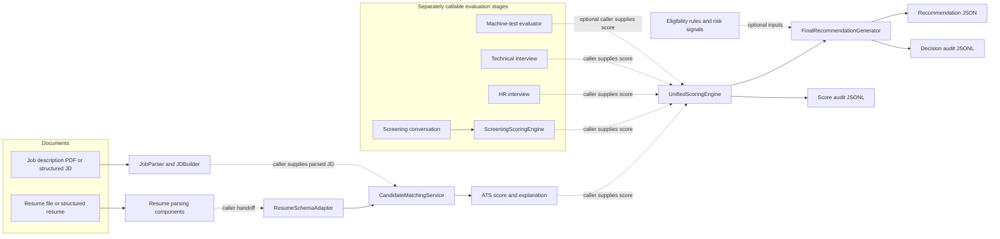
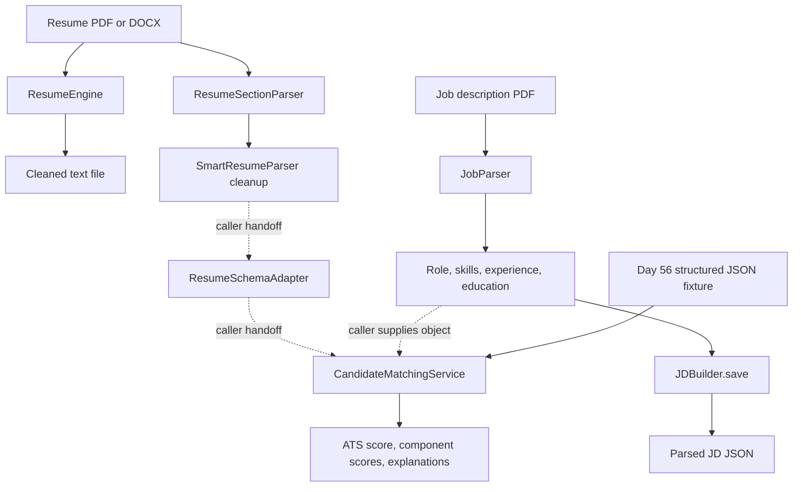
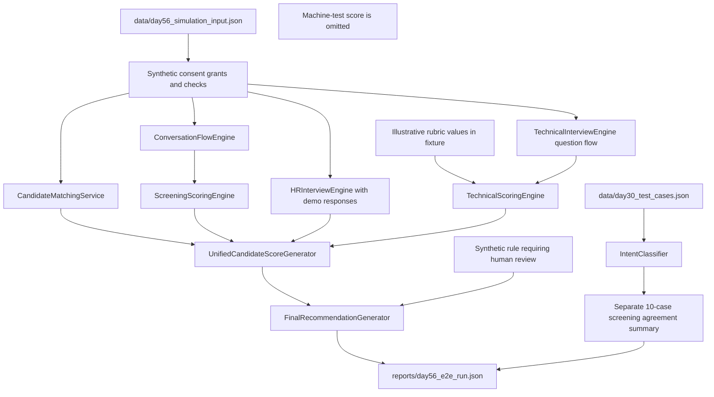
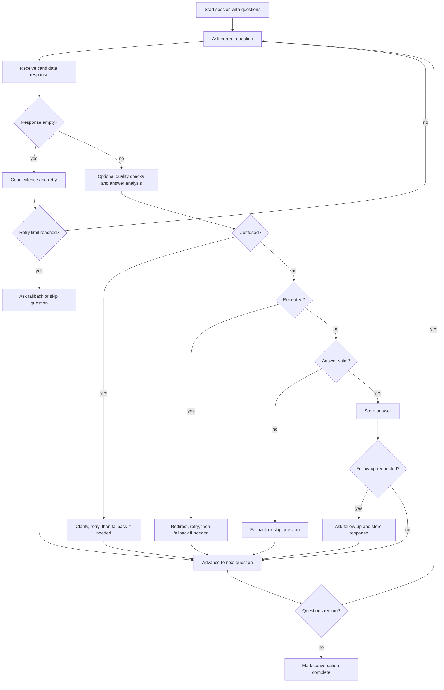

# Day 62 - Architecture Diagrams and Workflows

These diagrams describe the code present in the repository. Solid arrows show a flow implemented within a component or demonstrated by the Day 56 simulation. Dashed arrows show a caller-supplied handoff or an optional component; they do not mean that a production service automatically connects the steps.

## 1. Candidate evaluation modules

The dashed boundaries matter: most modules return Python objects or dictionaries. The calling code is responsible for passing outputs between stages. The Day 56 simulation is the repository's explicit synthetic integration example; its limits are shown below.

## 2. Document parsing and ATS handoff

ResumeEngine produces cleaned text; it does not produce the structured resume object expected by ATS matching. The structured parser and ATS adapter are callable separately, but the repository's standard resume scripts do not connect them automatically. The Day 56 simulation loads structured resume and job data directly from its fixture, bypassing file upload and document parsing.

## 3. Day 56 synthetic end-to-end simulation

What this simulation proves:

- The local script can join ATS, screening, HR, technical, unified scoring, and a final recommendation in one synthetic run.
- Score and decision audit records are written to a temporary directory during the run; the durable output is the JSON report.
- A separate human-reference dataset is used for screening-intent agreement. It does not contain a human rating for the simulated candidate.

What it does not prove:

- Candidate file upload or a PDF/DOCX parser-to-ATS handoff. The resume and job data are loaded from a structured JSON fixture.
- A machine-test scoring round. No machine-test score is supplied to unified scoring.
- Automatic technical scoring of free-text answers. The interview question flow is exercised, but the technical rubric values are supplied by the fixture.
- Production hiring accuracy, fairness, or throughput. HR answers are synthetic and use demonstration heuristics; the final recommendation receives an explicit review rule.

## 4. Screening conversation workflow

An answer analyzer is optional. When supplied, the Day 56 simulation uses Day29AnswerAdapter to connect semantic answer understanding to the state machine. Speech-to-text is available as a separate utility; no text-to-speech implementation is present in screening_ai/tts.py.

## 5. Interview score handoffs

| Stage | Session/result flow | Score passed onward |
|---|---|---|
| Screening | Conversation state machine stores accepted responses; screening scorer evaluates the questions and aggregates them. | Screening score on a 0-100 scale. |
| HR interview | HRInterviewEngine runs question flow and captures responses; analyzers and the HR scoring engine build component scores. | HR interview score on a 0-100 scale. |
| Technical interview | TechnicalInterviewEngine manages stage, difficulty, questions, and progress; the technical scoring engine consumes rubric component values. | Technical score on a 0-100 scale. |
| Machine test | MachineTestEvaluator validates task and submission data, evaluates components, and applies time adjustment. | Optional score on a 0-100 scale; not used in the Day 56 simulation. |

Unified scoring accepts stage scores; it does not start these interviews itself. Human review remains an explicit part of score, risk, and decision handling.

